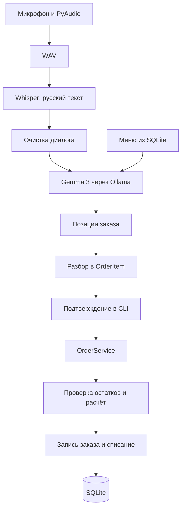

# AI Barista ☕

**Голосовой помощник для кофейни: от разговора с гостем до расчёта заказа и списания ингредиентов.**

AI Barista объединяет распознавание русской речи, локальную языковую модель и учёт заказов. Whisper переводит речь в текст, Gemma 3 извлекает позиции с учётом меню, а бизнес-логика проверяет наличие ингредиентов, считает стоимость и сохраняет заказ в SQLite.

Проект развивается как **локальный CLI-прототип**. В центре разработки — обработка заказов, адаптация модели к предметной области и разделение AI-компонентов и учётной логики.

## Пример сценария

Гость заказывает:

> Два американо и один латте с ванильным сиропом.

Целевой результат извлечения заказа:

```text
американо 2, латте сироп ванильный 10 1
```

Приложение преобразует позиции в `OrderItem`, получает цены и рецепты из базы, проверяет остатки и рассчитывает сумму. После подтверждения в CLI создаются записи заказа и списываются ингредиенты.

Это иллюстрация ожидаемого формата, а не измерение точности модели. Названия напитков и сиропов должны соответствовать меню.

## Возможности

| Компонент | Что реализовано |
|---|---|
| Голосовой ввод | Запись с микрофона через PyAudio в WAV |
| Распознавание речи | Русский язык, faster-whisper, модель `turbo`, CPU и INT8 |
| Подготовка диалога | Приведение к нижнему регистру, удаление приветствий и части пунктуации |
| Извлечение заказа | Gemma 3 12B через Ollama; меню, правила и пример диалога в промпте |
| Меню | Добавление и обновление позиций, получение цен и рецептов |
| Заказы | Несколько напитков, количество, дополнительные сиропы, расчёт стоимости |
| Склад | Проверка наличия ингредиентов и сиропов, списание, поиск низких остатков |
| Хранение | SQLite: меню, рецепты, заказы, позиции заказов и остатки |
| Тестирование | Тест бизнес-логики составного заказа с mock-репозиториями |

В `core/telegram_bot/` также есть отдельный модуль уведомлений об остатках. Он не подключён к основному сценарию `main.py`.

## Как проходит заказ



Модель отвечает за интерпретацию диалога. Цены, рецепты, наличие ингредиентов и списание определяются обычным Python-кодом и данными SQLite.

### Адаптация модели под кофейню

Промпт формируется из актуального списка напитков и сиропов. В нём заданы формат ответа, значения по умолчанию, правила для отдельных напитков и пример извлечения заказа из диалога.

Основные параметры текущей реализации:

```python
# Распознавание речи
WhisperModel("turbo", device="cpu", compute_type="int8")

# Извлечение заказа
AssistantRepository(menu, model="gemma3:12b")
```

Используется настройка промпта и примеров. Код обучения весов модели и обучающий датасет в текущую версию репозитория не входят.

## Архитектура

Приложение разделено на сервисы и репозитории внутри одного Python-процесса. Ollama вызывается отдельным CLI-процессом.

```text
AI-barista/
├── main.py                         # Основной CLI-сценарий
├── core/
│   ├── ai_assistant/
│   │   ├── assistant_repository.py # Вызов Ollama и формирование промпта
│   │   ├── assistant_service.py    # Обработка ответа модели
│   │   ├── parser.py               # Очистка распознанного диалога
│   │   └── prompt_templates.py     # Правила и примеры извлечения заказа
│   ├── infrastructure/
│   │   ├── voice/                  # Запись звука и транскрибация
│   │   ├── database/
│   │   │   ├── database_manager.py # Подключение к SQLite
│   │   │   └── repositories/       # Меню, сиропы, склад и заказы
│   │   └── services/               # MenuService и OrderService
│   └── telegram_bot/               # Отдельный модуль уведомлений
└── tests/
    └── order_test.py                # Проверка составного заказа
```

`OrderService` работает с репозиториями через переданные зависимости. Это позволяет проверять расчёт и списание с mock-объектами без микрофона, Ollama и реальной базы.

## Подготовка окружения

Нужны Python 3.10+, микрофон, PortAudio и установленный [Ollama](https://ollama.com/download). Требования к памяти зависят от выбранной модели; по умолчанию используется [Gemma 3 12B](https://ollama.com/library/gemma3:12b).

### 1. Получить код и создать окружение

```bash
git clone https://github.com/uusuri/AI-barista.git
cd AI-barista
python3 -m venv .venv
source .venv/bin/activate
```

Команды активации показаны для bash/zsh на Linux и macOS.

### 2. Установить зависимости

На macOS для сборки PyAudio понадобится PortAudio:

```bash
brew install portaudio
```

Python-зависимости устанавливаются явно: файла `requirements.txt` в текущей версии ещё нет.

```bash
python -m pip install faster-whisper pyaudio python-dotenv pytest
```

Для отдельного Telegram-модуля дополнительно нужен `python-telegram-bot`. Инструкции по установке PyAudio для других ОС есть в [документации проекта](https://people.csail.mit.edu/hubert/pyaudio/).

### 3. Загрузить модель

```bash
ollama pull gemma3:12b
ollama run gemma3:12b
```

После проверки модели выйдите из интерактивного режима Ollama. Whisper при первом использовании также может загружать модель, поэтому для первоначальной подготовки нужен интернет.

### 4. Подготовить базу данных

Для запуска нужна **готовая SQLite-база с меню, рецептами и остатками**. Скрипта создания и заполнения схемы в репозитории пока нет; одной пустой базы недостаточно.

Ожидаемые таблицы:

```text
menu                 — напитки, цены и доступность
ingredients          — ингредиенты, единицы измерения и остатки
syrups               — сиропы, цены порций и остатки
recipe               — состав напитков
orders               — заказы
order_items          — позиции заказа
order_item_syrups     — дополнительные сиропы
```

Укажите абсолютный путь к подготовленной базе в переменной `DB_PATH` или локальном `.env`:

```dotenv
DB_PATH=/absolute/path/to/coffee_shop.db
```

Замените пример своим путём. Абсолютный путь исключает неоднозначность относительно каталога, из которого запускается приложение. Для отдельного Telegram-модуля используется `BOT_TOKEN`; он не нужен основному CLI-сценарию.

### 5. Запустить CLI

Из корня репозитория:

```bash
PYTHONPATH=core python main.py
```

`PYTHONPATH=core` нужен из-за текущего сочетания импортов `ai_assistant` и `core.infrastructure` в `main.py`.

При импорте модуля записи приложение обращается к микрофону и записывает примерно 8 секунд аудио. Разрешите доступ к микрофону и произнесите заказ. Затем приложение распознает речь, запрашивает модель и предлагает выбрать действие.

Для оформления заказа выберите `order`, введите имя клиента, тип оплаты и подтверждение `y`. `cash` и `card` — учётные значения; платёжный шлюз в проекте не подключён.

Другие доступные ветки CLI: `add`, `update`, `menu`, `stock`, `price`, `recipe`. Пункт `delete` присутствует в приглашении ввода, но обработчик этого действия в `main.py` пока не реализован.

## Тесты

```bash
python -m pytest -q tests/order_test.py
```

Тест `test_large_order` проверяет составной заказ из пяти напитков: создание заказа и суммарное списание ингредиентов и сиропов. Репозитории заменены `MagicMock`, поэтому тесту не нужны база данных, микрофон и загруженные модели.

## Следующие шаги

- [ ] Добавить зависимости с зафиксированными версиями и скрипт инициализации SQLite.
- [ ] Перенести запись звука из импорта в явный вызов основного сценария.
- [ ] Унифицировать импорты и упростить запуск из корня проекта.
- [ ] Добавить строгую схему ответа модели и проверку неизвестных позиций.
- [ ] Вынести подтверждение заказа за пределы цикла разбора позиций.
- [ ] Объединить создание заказа и списание в одну транзакцию.
- [ ] Расширить тесты: нехватка ингредиентов, неверный ответ модели, многопозиционные заказы.
- [ ] Добавить REST API и интерфейс подтверждения заказа.

---

Автор — [Алексей Куницкий](https://github.com/uusuri).
